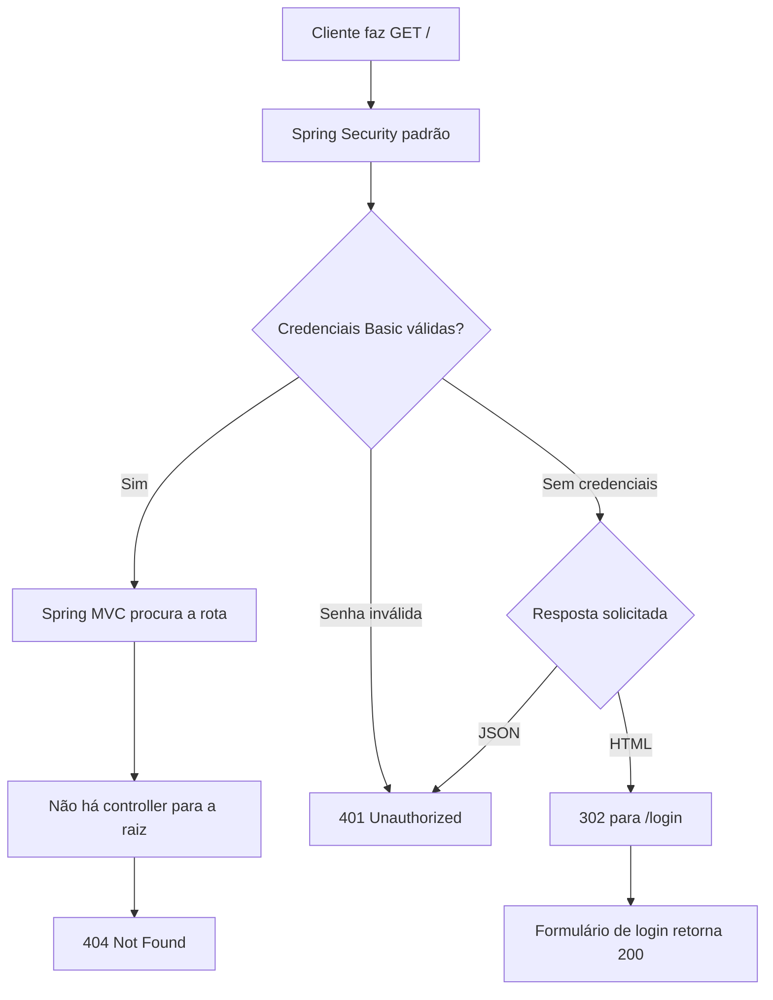
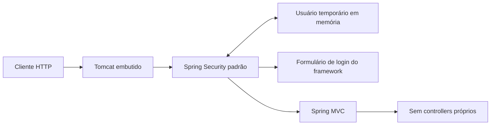
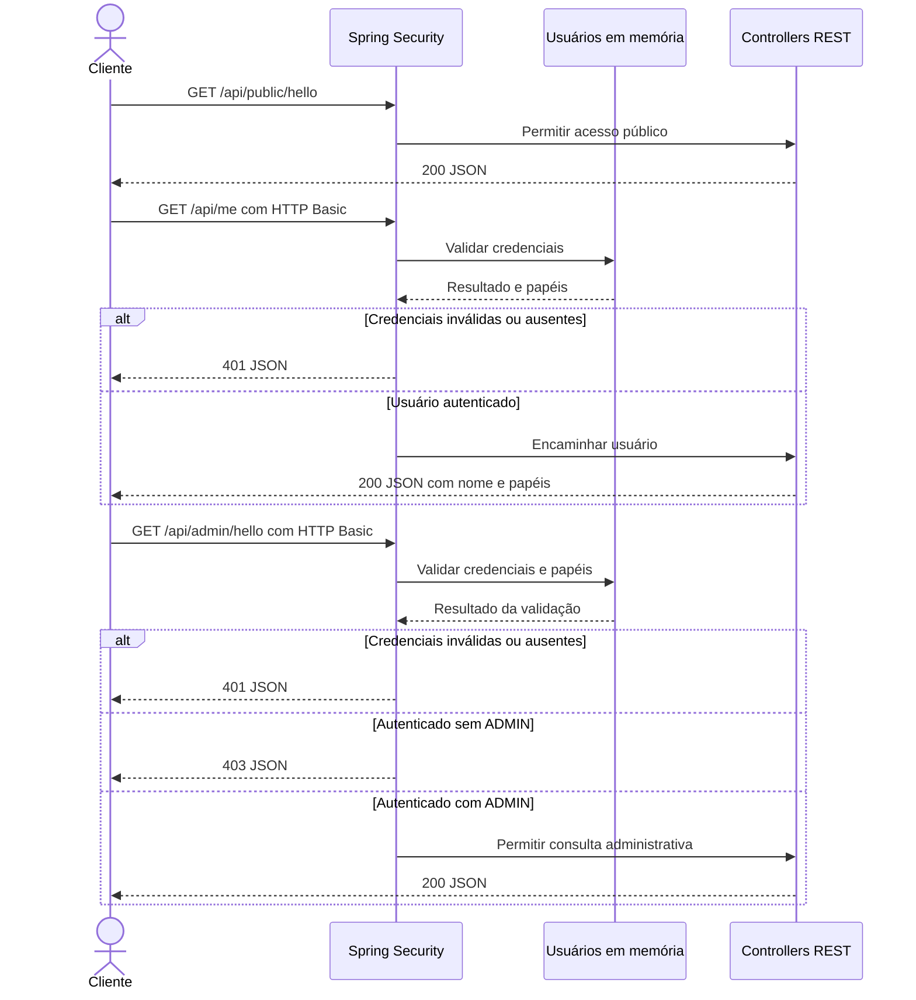

# Fluxograma e diagrama da API

Os diagramas distinguem o comportamento disponível das próximas entregas. O GitHub renderiza os blocos Mermaid diretamente.

## Fluxograma atual

Fluxo das consultas `GET /` e acesso ao formulário padrão nesta primeira entrega:

## Arquitetura atual

A aplicação possui segurança padrão, mas ainda não expõe API de negócio, cadastro ou tokens JWT. Não há frontend ou banco de dados.

## API planejada para as entregas 2 e 3

**Este contrato ainda não está implementado.** A proposta é demonstrar HTTP Basic, respostas JSON e acesso por perfil em três consultas.

| Método e rota planejada | Acesso | Resposta esperada |
| --- | --- | --- |
| `GET /api/public/hello` | Livre | 200 com mensagem |
| `GET /api/me` | Autenticado | 200 com nome e papéis; 401 sem autenticação válida |
| `GET /api/admin/hello` | ADMIN | 200 para ADMIN; 401 sem autenticação válida; 403 para USER |

Atualizar estes diagramas junto com os testes e a documentação de cada entrega. A política de sessão e CSRF será explicitada quando a configuração própria da API for implementada.
