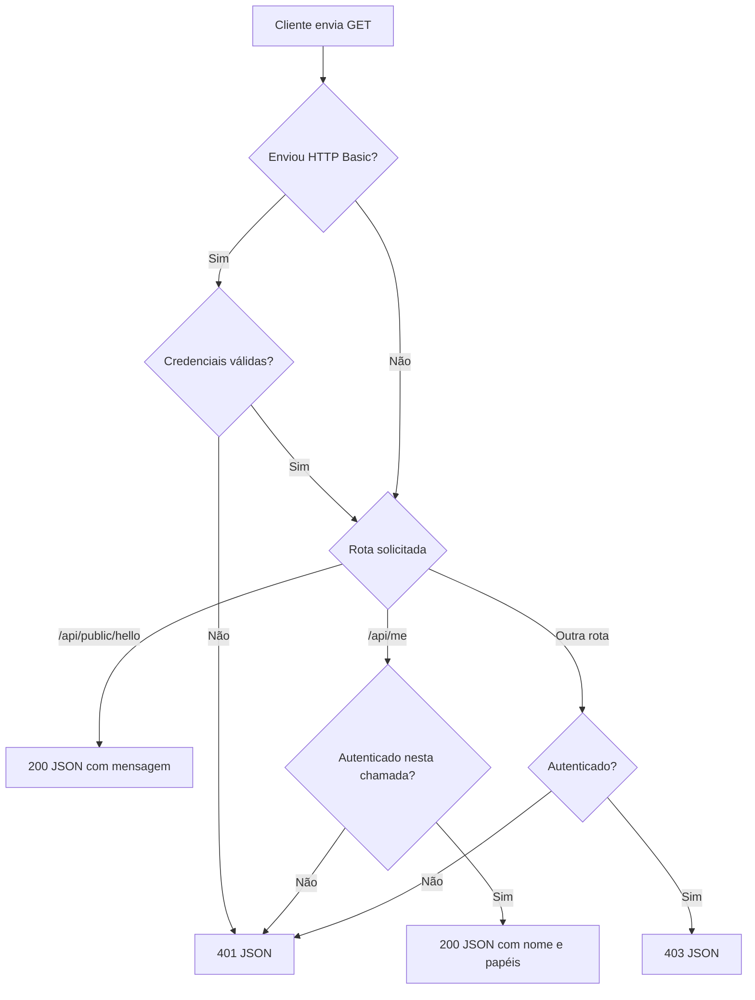
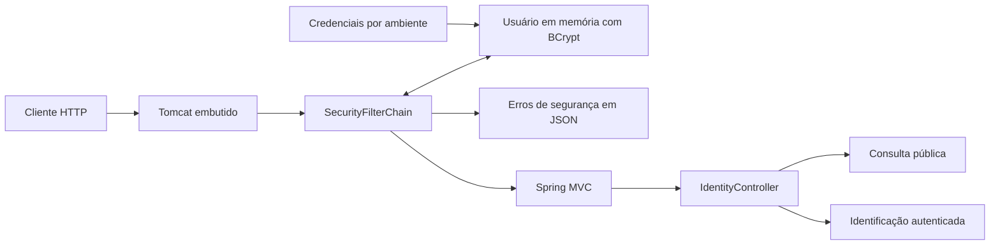
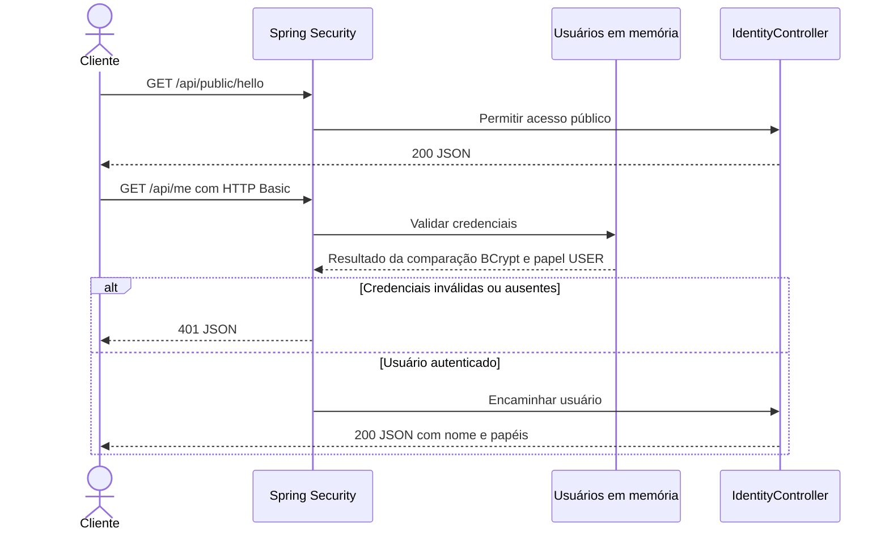

# Fluxograma e diagrama da API

Os diagramas distinguem o comportamento disponível das próximas entregas. O GitHub renderiza os blocos Mermaid diretamente.

## Fluxograma atual

Fluxo das consultas GET desta segunda entrega. Credenciais inválidas enviadas explicitamente são rejeitadas antes da autorização, inclusive na rota pública.

## Arquitetura atual

A autenticação é HTTP Basic e não é persistida em sessão. A proteção CSRF permanece ativa; o fluxo acima resume somente GETs. Não há formulário de login, cadastro, emissão de tokens, frontend ou banco de dados.

## API disponível

Os dois endpoints abaixo estão implementados e cobertos por testes HTTP com autenticação real.

| Método e rota | Acesso | Resposta |
| --- | --- | --- |
| `GET /api/public/hello` | Livre | 200 com mensagem |
| `GET /api/me` | Autenticado | 200 com nome e papéis; 401 sem autenticação válida |

## Próxima entrega: acesso administrativo

`GET /api/admin/hello` ainda não está implementado. A terceira entrega incluirá o usuário ADMIN, a regra administrativa e testes dos resultados 200, 401 e 403. Atualmente essa rota segue o bloqueio padrão das rotas não liberadas.

Atualizar estes diagramas junto com os testes e a documentação da terceira entrega.
