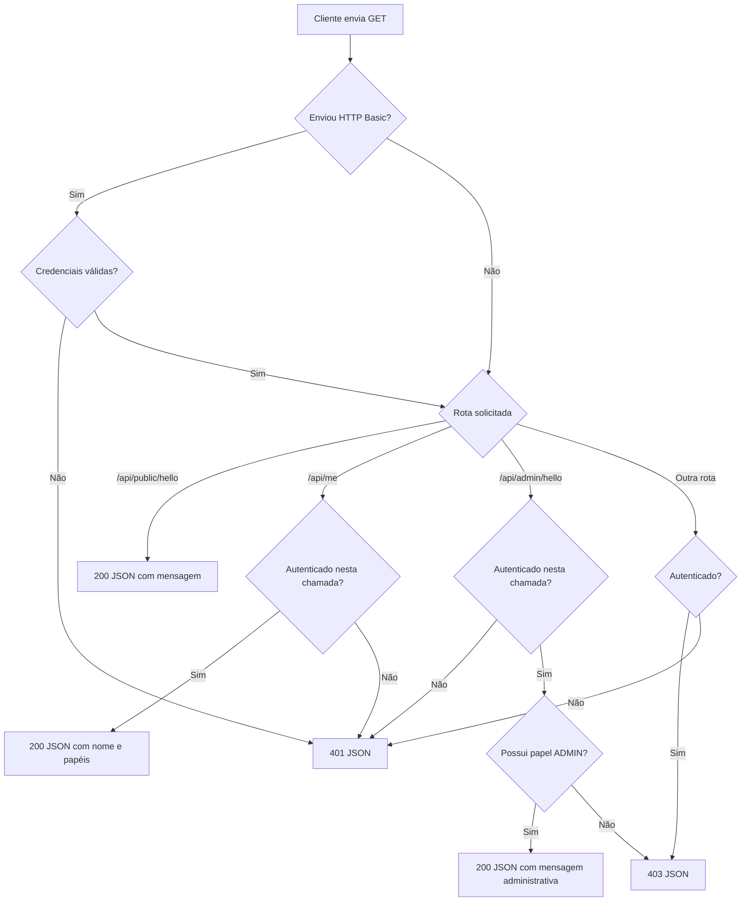
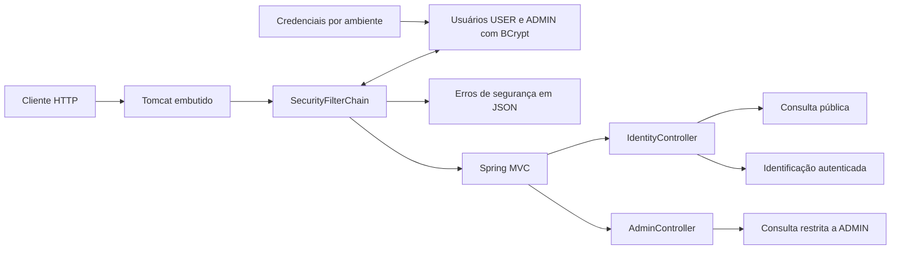
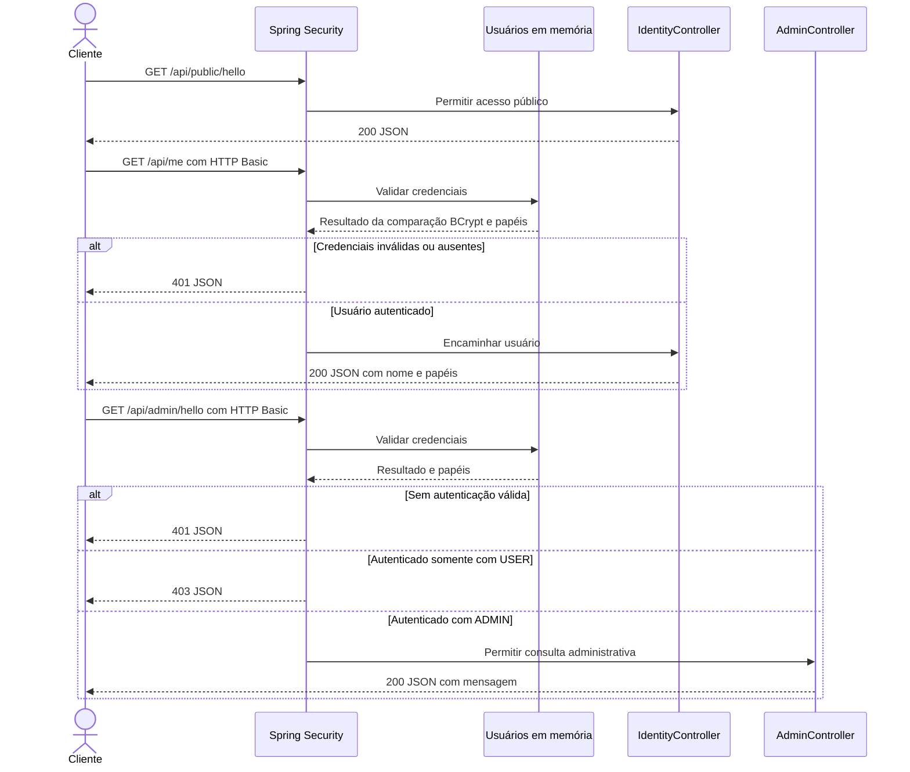

# Fluxograma e diagrama da API

Os diagramas distinguem o comportamento disponível das próximas entregas. O GitHub renderiza os blocos Mermaid diretamente.

## Fluxograma atual

Fluxo das consultas GET desta terceira entrega. Credenciais inválidas enviadas explicitamente são rejeitadas antes da autorização, inclusive na rota pública.

## Arquitetura atual

A autenticação é HTTP Basic e não é persistida em sessão. A proteção CSRF permanece ativa; o fluxo acima resume somente GETs. Não há formulário de login, cadastro, emissão de tokens, frontend ou banco de dados.

## API disponível

Os três endpoints abaixo estão implementados e cobertos por testes HTTP com autenticação real.

| Método e rota | Acesso | Resposta |
| --- | --- | --- |
| `GET /api/public/hello` | Livre | 200 com mensagem |
| `GET /api/me` | Autenticado | 200 com nome e papéis; 401 sem autenticação válida |
| `GET /api/admin/hello` | ADMIN | 200 para administrador; 403 para USER; 401 sem autenticação válida |

## Configuração dos usuários

O usuário comum é configurado por `DEMO_USER_NAME` e `DEMO_USER_PASSWORD`. O administrador usa `DEMO_ADMIN_NAME` e `DEMO_ADMIN_PASSWORD`, com os papéis `USER` e `ADMIN`. As duas senhas são obrigatórias; os nomes precisam ser distintos mesmo desconsiderando maiúsculas. `/api/me` retorna apenas nome e papéis, inclusive para ADMIN.

O administrador continua sujeito ao bloqueio das rotas não liberadas e não transfere permissões para a próxima requisição sem credenciais. A próxima entrega adicionará a verificação automática no GitHub e o acompanhamento de dependências.
